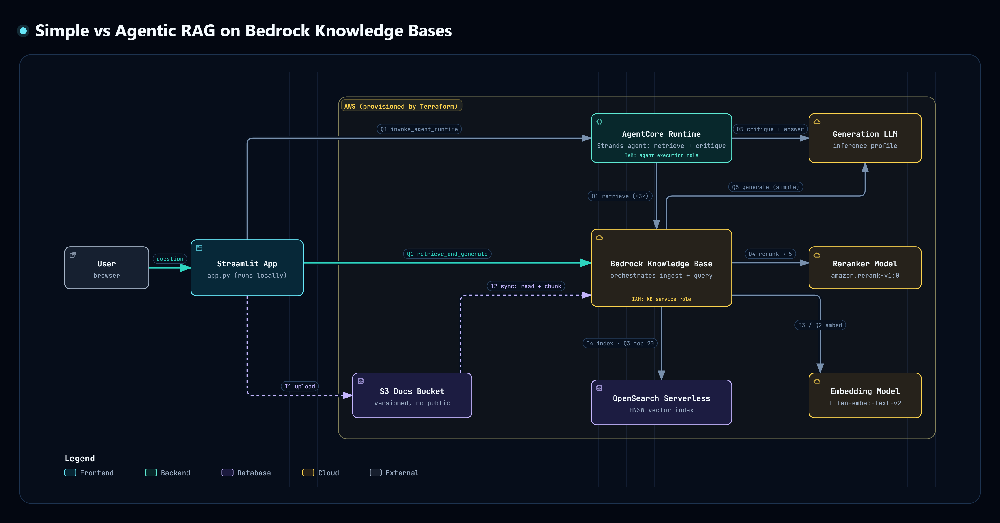

## Agentic RAG on AWS Bedrock KnowledgeBase, OpenSearch, S3, Strands Agent, Bedrock AgentCore with Embedding, Reranker, Generative Models 

A minimal Retrieval-Augmented Generation app: Terraform provisions the AWS
backend (S3 + Bedrock Knowledge Base + OpenSearch Serverless), and a local
Streamlit app handles document upload, Knowledge Base sync, and querying.

## Architecture

- **Terraform** (`terraform/`) — S3 bucket for source documents, an
  OpenSearch Serverless vector collection, a Bedrock Knowledge Base wired to
  both, and (for the agentic RAG comparison) an ECR repo + IAM execution role
  + Bedrock AgentCore Runtime for the agent in `agent/`.
- **Streamlit app** (`app/`) — runs locally, talks to AWS via boto3 using
  your local AWS credentials.
- **Agent** (`agent/`) — a small Strands agent deployed to Bedrock AgentCore
  Runtime, used only by the optional "Agentic RAG (compare)" checkbox in the
  UI. See [Agentic RAG comparison](#agentic-rag-comparison) below.



Step-by-step sequence diagrams (open the `.html` files in a browser to explore them interactively):
[Simple RAG](diagram/rag-sequence-simple.html) · [Agentic RAG](diagram/rag-sequence-agentic.html) · [Architecture](diagram/rag-architecture.html)

## Key concepts

- **Embedding model** (`amazon.titan-embed-text-v2:0`): turns text into a
  1024-dimensional vector, so that texts with similar meaning end up close
  together. Each chunk is embedded once, at ingestion. The question is embedded
  at query time, and OpenSearch returns the nearest chunk vectors (k-NN). This
  step is fast, but it compares question and chunk only indirectly, as two
  separate vectors [2].
- **Reranker** (`amazon.rerank-v1:0`): a cross-encoder model that reads the
  question and each candidate chunk *together* and scores how well the chunk
  answers it. Vector search over-fetches 20 candidates (recall), and the
  reranker keeps the best 5 (precision). Better chunks reach the LLM, and the
  context stays short. LLMs use short, relevant context better than long, noisy
  context [5]. → [details](#why-the-reranker-improves-simple-rag)
- **Agentic RAG**: instead of a single retrieve → generate pass, an agent loops:
  it writes its own queries, retrieves, critiques whether the context is enough,
  and retrieves again if not. This fixes *missed topics* (recall), mainly on
  compound and multi-hop questions [6–9]. It costs more model calls.
  → [details](#why-agentic-rag-is-better-for-the-right-questions)

## Ingestion phase

- User uploads a document through the Streamlit UI.
- The app writes it straight to the S3 docs bucket.
- User clicks "Sync Knowledge Base" in the UI.
- This calls Bedrock's `StartIngestionJob` on the Knowledge Base's S3 data source.
- Bedrock reads new/changed objects from S3, chunks them (fixed-size, configurable via Terraform variables), embeds each chunk with **Titan Text Embeddings v2**, and writes the vectors into the OpenSearch Serverless collection.

## Querying phase

- User types a question into the Streamlit chat input.
- The app calls Bedrock's `retrieve_and_generate` against the Knowledge Base, using Claude Sonnet 4.5 as the generation model.
- Bedrock retrieves the 20 nearest chunks from OpenSearch Serverless, the **Amazon Rerank 1.0** reranker (`amazon.rerank-v1:0`) re-scores them against the question and keeps the best 5, and the model generates an answer with source citations from those 5. See [Why the reranker improves Simple RAG](#why-the-reranker-improves-simple-rag).
- The answer and its sources are shown in the main chat pane and appended to the session's chat history in the left sidebar.

## Prerequisites

- **Bedrock model access enabled** in the target AWS account/region for `amazon.titan-embed-text-v2:0` and the Claude Sonnet 4.5 inference profile (`us.anthropic.claude-sonnet-4-5-20250929-v1:0`). Enable this in the Bedrock console under "Model access" before applying — Terraform will provision the Knowledge Base successfully even without it, but ingestion and querying will fail with `AccessDeniedException`.
- **Local AWS credentials with permissions** to run Terraform, plus (since the app calls AWS directly with your local credentials, not through the Knowledge Base's IAM role): `s3:PutObject` on the docs bucket, `bedrock:StartIngestionJob`, `bedrock:GetIngestionJob`, `bedrock:RetrieveAndGenerate`, and `bedrock:InvokeModel` on both the inference profile ARN and the underlying foundation-model ARNs. For reranking you also need `bedrock:Rerank` and `bedrock:InvokeModel` on `arn:aws:bedrock:<region>::foundation-model/amazon.rerank-v1:0` (Terraform grants the Knowledge Base service role the same permissions for the agent's `Retrieve` calls).
- **Reranker region support**: `amazon.rerank-v1:0` is available in eu-central-1, us-west-2, ca-central-1 and ap-northeast-1, but **not** in us-east-1. There, set the Terraform variable `rerank_model_id = "cohere.rerank-v3-5:0"`.
- Manually test on above on (GUI) AWS Console, Bedrock playground.

## Quick start

Needs: Terraform, Docker (with buildx), the AWS CLI with working credentials,
and Python 3.

```bash
# 1. Deploy everything to AWS
./deploy.sh

# 2. Run the app (opens http://localhost:8501)
pip install -r app/requirements.txt   # first time only
python3 app/app.py
```

`./deploy.sh`:

1. creates the AWS stack with Terraform (S3, OpenSearch Serverless, Bedrock
   Knowledge Base, ECR, IAM),
2. builds the agent's `linux/arm64` image, pushes it to ECR, and runs it on
   **Bedrock AgentCore Runtime**,
3. turns on AgentCore Observability (see
   [Seeing the agent's sessions and prompts](#seeing-the-agents-sessions-and-prompts)),
4. writes `app/.env` and `agent/.env` from the Terraform outputs
   (`terraform/app_config.tf`), so there's nothing to configure.

When you're done: `./deploy.sh destroy` deletes every AWS resource the project
created.

- The first run takes about 10–15 minutes (OpenSearch Serverless is slow to
  create). Later runs only change what changed. The agent image is tagged with
  a hash of its code, so it's rebuilt and redeployed only when `agent/` changes.
- It creates real, billable AWS resources. An OpenSearch Serverless collection
  costs money for as long as it exists, so run `./deploy.sh destroy` when you're
  done.
- AgentCore only runs ARM64 images. On an x86 machine the script installs QEMU
  emulation for Docker once (`tonistiigi/binfmt`), so the image can be
  cross-built.
- No AgentCore **Gateway** is needed. The agent calls the Knowledge Base
  `Retrieve` API with its IAM role, and the Knowledge Base itself talks to
  OpenSearch, the embedding model and the reranker. A Gateway is for exposing
  APIs to agents as MCP tools; this design doesn't need one.
- To compare answers without the reranker:
  `terraform -chdir=terraform apply -var="enable_reranking=false"`.
- Don't edit `app/.env` by hand: the next apply overwrites it.

## Seeing the agent's sessions and prompts

**In the app:** with "Also run Agentic RAG (compare)" ticked, every agentic
answer has a **"Ran on Bedrock AgentCore "** panel. It shows:

- the runtime, **session ID**, **trace ID** and AWS request ID, as returned by
  the `InvokeAgentRuntime` API,
- the container's host name and the session ID the agent saw *inside* its
  AgentCore container. 

All questions from one browser session share one session ID, so they appear as
one session in the console.

**In AWS:** open **Bedrock AgentCore → Observability** (the panel links to it),
pick `simple_rag_agent`, then **Sessions** → your session ID → a trace. Each
trace shows the agent loop step by step: the prompts sent to the LLM, the
`retrieve_kb` and `critique_context` tool calls with their inputs and outputs,
token counts and latency. New traces take a few minutes to appear.

How it's enabled (all done by `./deploy.sh`):

| Piece | Where |
|---|---|
| CloudWatch **Transaction Search** (one-time, per account) | `deploy.sh`, `enable_transaction_search` |
| Agent runs under ADOT (`opentelemetry-instrument`), which exports the Strands spans | `agent/Dockerfile`, `agent/requirements.txt` |
| Runtime-level tracing (the console's "Tracing" toggle) | `terraform/agentcore.tf`, `aws_cloudwatch_log_delivery*` |
| IAM for spans, logs and metrics | `terraform/agentcore.tf`, execution role |
| A `runtimeSessionId` sent with each call | `app/utils/agentcore_ops.py` |

## Manual test plan

1. Upload a sample document via the UI.
2. Click "Sync Knowledge Base" and wait for the status to show `COMPLETE`.
3. Ask a question whose answer only appears in the uploaded document.
4. Verify the answer is correct and cites the uploaded document.

## Teardown

```bash
./deploy.sh destroy
```

Afterwards, check in the AWS console that the OpenSearch Serverless collection
is gone, because it costs money for as long as it exists.

## Agentic RAG comparison

The base app answers every question with **Simple RAG**: one call to
Bedrock's `RetrieveAndGenerate`, which issues a single retrieval against the
Knowledge Base and generates from whatever the top-k returns.

`agent/` adds an **Agentic RAG** path: a Strands agent, deployed to AWS
Bedrock AgentCore Runtime, with two tools:

- `retrieve_kb(query)` — the Knowledge Base's raw `Retrieve` API, callable up
  to 3 times per question.
- `critique_context(question)` — checks whether everything retrieved so far
  is actually enough to answer the question.

The agent's own reasoning loop decides whether to retrieve once or several
times — e.g. splitting a compound question into one retrieval per sub-topic,
or reformulating the query when a retrieval looks thin — before writing the
final answer strictly from what it retrieved.

Both paths use the same generation model, so any difference in answer
quality comes from the retrieval strategy, not the model.

### How it works

Step by step, for one question:

1. **Simple RAG** — the app calls Bedrock's `RetrieveAndGenerate` once. This
   does three things internally: retrieve 20 candidate chunks for the raw
   question text, rerank them with `amazon.rerank-v1:0` down to the best 5,
   then generate an answer from those 5. One retrieval, no
   feedback loop — if the top-k misses part of the question, the answer will
   too.
2. **Agentic RAG** — the app invokes the AgentCore Runtime agent instead:
   1. The agent picks a focused query (not necessarily the raw question —
      e.g. one sub-topic of a compound question) and calls its
      `retrieve_kb(query)` tool, which hits the Knowledge Base's raw
      `Retrieve` API with the same 20 → 5 reranking (chunks + source URIs
      only, no generation yet). The full text of each chunk goes back to the
      agent, because the final answer is written from these tool results.
   2. It calls `critique_context(question)`, a second, low-temperature model
      call that looks at everything retrieved *so far* against the original
      question and returns `{"sufficient": bool, "missing_aspects": [...]}`.
   3. If not sufficient and it hasn't used its 3-call retrieval budget yet,
      it reformulates the query (or targets a `missing_aspect`) and repeats
      from step 1.
   4. Once sufficient (or the budget runs out), it writes the final answer
      using only the chunks it collected across all its retrieval calls,
      citing sources.
   Every retrieval call and every critique verdict is recorded and returned
   as the `trace` — that's what the "Retrieval trace" expander in the GUI
   shows.

Both paths use the same generation model (the KB's `generation_model_id`),
so any difference in answer quality comes from the retrieval strategy, not
the model.

### Simple RAG vs Agentic RAG

| | Simple RAG (`app/utils/bedrock_ops.py`) | Agentic RAG (`agent/agent.py`) |
|---|---|---|
| Retrieval | 1 call, using the raw question | 1–3 calls; the agent writes its own queries |
| Compound question ("A vs B") | Top-k often covers only A or only B | Can retrieve A, then B |
| Self-check | None | `critique_context` asks "is this enough?" |
| Reranker (`amazon.rerank-v1:0`) | Yes: 20 candidates → best 5 | Yes: 20 candidates → best 5, on every retrieval |
| Visibility into *why* an answer looks the way it does | None | Retrieval trace (queries, chunk counts, critique verdicts) |
| Cost and latency | ~1 model call + 1 rerank | ~3–7 model calls (Sonnet each time) + 1 rerank per retrieval |
| Single-topic question | Good enough | Same result, 3–5× the cost |

Both paths use the same generation model, the same reranker, and the same
number of final chunks per retrieval (5). So any difference in answer
quality comes from the retrieval *strategy*, not from the model or the
retrieval settings.

### Why Agentic RAG is better (for the right questions)

Simple RAG makes one bet: it embeds the raw question, takes the nearest
chunks, and generates. If that one retrieval misses part of the question,
the answer misses it too, and nothing notices.

Agentic RAG turns retrieval into a loop with feedback:

- **It splits compound questions.** "Compare LoRA and RLHF" is really two
  questions. One embedding of the whole sentence lands somewhere between the
  two papers, and the top-5 is usually dominated by one of them. The agent
  retrieves "LoRA cost reduction" and "RLHF cost" separately, so both sides
  get evidence.
- **It rewrites weak queries.** A user's wording often doesn't match the
  wording in the paper. When a retrieval comes back thin, the agent
  reformulates (synonyms, the paper's own terminology) and tries again.
- **It checks before answering.** `critique_context` compares everything
  retrieved so far with the question and names the missing aspects, so the
  next retrieval targets what is actually missing instead of guessing.
- **It shows its work.** The retrieval trace explains *why* the answer looks
  the way it does, which makes bad answers debuggable.

What it does **not** fix: if the right chunk ranks poorly for a good query,
asking more times doesn't help much. That is a *precision* problem, and it is
what the reranker is for. Agentic RAG improves *recall* (did we fetch all
the needed topics?); the reranker improves *precision* (are the chunks we
kept the most relevant ones?).

The trade-off is explicit: Agentic RAG spends more calls and latency to
reduce the chance of an incomplete or off-target retrieval. That's exactly
why the GUI makes it opt-in rather than always-on.

### Why the reranker improves Simple RAG

Vector search ranks chunks by **embedding similarity**: the question and each
chunk are embedded *separately*, and the closest vectors win. That is fast,
but coarse. A chunk that merely *talks about the same topic* (an
introduction, a related-work paragraph, a different paper using the same
terms) can score as high as the chunk that actually *answers* the question.

A reranker is a **cross-encoder**: it reads the question and each candidate
chunk *together* and scores how well that chunk answers that question. It is
too slow to run over the whole index, but cheap on 20 candidates. So the
pipeline becomes:

1. **Recall stage** – vector search fetches 20 candidates (wide net, so the
   right chunk is very likely somewhere in the list).
2. **Precision stage** – `amazon.rerank-v1:0` re-scores those 20 and keeps
   the best 5.
3. **Generation** – the model answers from those 5.

Why this matters especially for Simple RAG: it has exactly one retrieval
and no way to try again, so whatever lands in its context window *is* the
answer. Without reranking, a near-miss chunk at rank 3 and the right chunk
at rank 7 means the right chunk never reaches the model. With reranking, the
right chunk is pulled up into the top 5. Fewer off-topic chunks in the
context also means less chance of the model mixing in unrelated content.

The agent benefits too: cleaner chunks per retrieval mean `critique_context`
reaches "sufficient" sooner, so it usually needs fewer loops.

Cost: one Rerank call per retrieval, with no LLM involved, which is small
next to the generation call. To measure the effect yourself, ask the same
question with `RERANK_MODEL_ARN` set and with it empty.

### Sample test prompts

Try each of these with "Agentic RAG (compare)" checked, after uploading and
syncing the PDFs in `docs/pdfs/` (or your own documents covering similar
topics):

1. **Single-topic baseline** — expect both paths to do about equally well,
   since one retrieval is already enough:
   > What is retrieval-augmented generation and why was it introduced?

2. **Compound / cross-document** — expect Simple RAG to lean on whichever
   paper dominates its single top-k retrieval (often just one side of the
   comparison), while Agentic RAG's trace shows two separate retrieval calls
   (one per paper) and a more balanced answer:
   > Compare how LoRA and RLHF each reduce the cost of adapting large
   > language models.

3. **Compound / cross-document** — same pattern, different pair of papers:
   > How do ReAct and Tree of Thoughts differ in how they structure an
   > LLM's reasoning process?

4. **Related-but-distinct papers** — tests whether retrieval correctly
   separates "the problem" from "the fix" across two papers instead of
   blending them from a single retrieval pass:
   > What problem does FlashAttention solve in the self-attention mechanism
   > from "Attention Is All You Need", and how does it fix it?

For each, compare: does the Simple RAG answer fully address every part of
the question, or does it drift toward only one topic? Does Agentic RAG's
trace show it retrieving separately for each topic, and does its final
answer read as more complete?

### Deploying the agent

`./deploy.sh` deploys the agent along with everything else. It records the
image URI in `terraform/agent.auto.tfvars`, so a later plain `terraform apply`
keeps the AgentCore Runtime instead of deleting it. The deployed agent shows up
in the AWS console under **Bedrock AgentCore → Runtime**, and its
`AGENT_RUNTIME_ARN` is written into `app/.env` automatically.

**Local dev loop (optional)**: run the agent on your machine instead of
AgentCore, using your own AWS credentials. `agent/.env` is written by the
deploy:

```bash
cd agent
pip install -r requirements.txt
python3 agent.py "your question"
```

